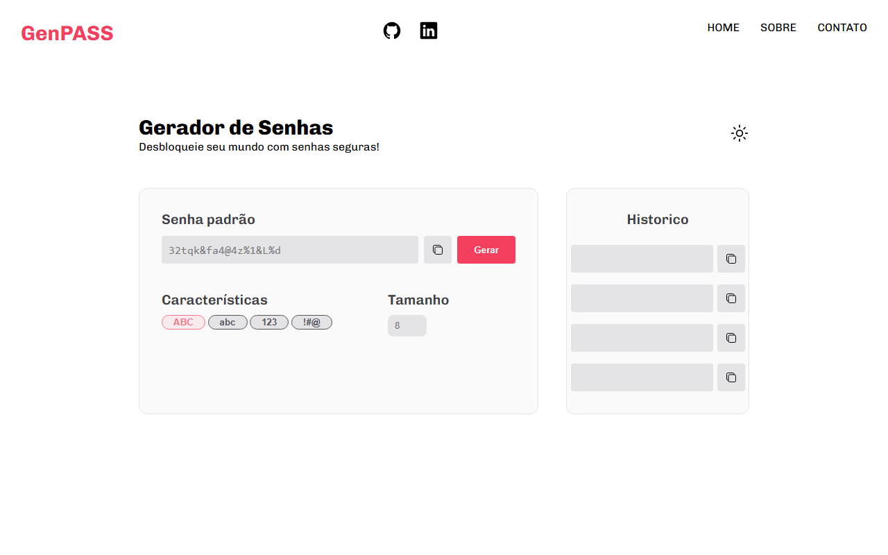

<!-- portfolio: Aplicação web -->

<h1 align="center">GenPASS · Gerador de Senhas</h1>

<p align="center">Desbloqueie seu mundo com senhas seguras.</p>

<p align="center">
  
</p>

<p align="center">
  <a href="https://reury-cardoso.github.io/generate-password/"><strong>Ver online</strong></a>
</p>

## Sobre

Gerador de senhas aleatórias feito com HTML, CSS e JavaScript puro, sem dependências. Você escolhe os tipos de caractere e o tamanho, gera a senha e copia com um clique.

## Funcionalidades

- Geração de senha aleatória com tamanho definido pelo usuário
- Seleção dos tipos de caractere: maiúsculas (`ABC`), minúsculas (`abc`), números (`123`) e símbolos (`!#@`)
- Aviso quando nenhuma característica está selecionada
- Botão para copiar a senha gerada
- Histórico com as últimas senhas, cada uma com seu botão de copiar

## Tecnologias

- HTML5
- CSS3
- JavaScript (ES6+)

## Como rodar

Não precisa instalar nada. Baixe o repositório e abra o `index.html` no navegador:

```bash
git clone https://github.com/reury-cardoso/generate-password.git
cd generate-password
```

## Estrutura

```text
├── index.html   # estrutura da página
├── style.css    # estilos e layout
├── script.js    # geração da senha, histórico e cópia
└── assets/      # ícones
```

## Autor

Feito por [Reury Cardoso](https://github.com/reury-cardoso).
